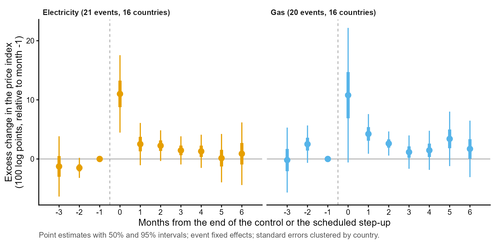
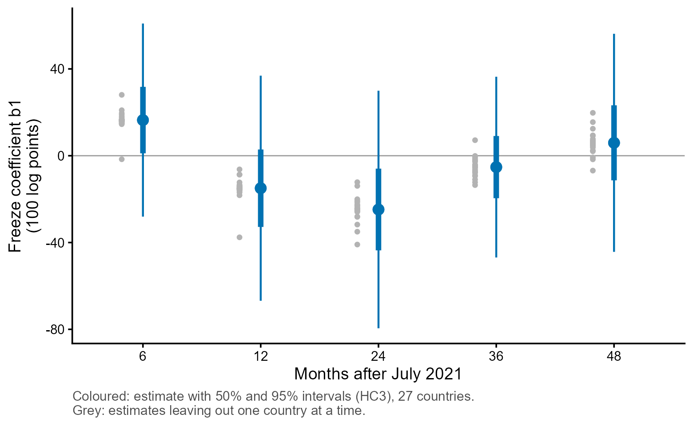

# Do Energy Price Controls Prevent Inflation or Postpone It?

When wholesale energy prices jump, governments can let retail prices follow, freeze them and raise them later, or cap part of consumption. This project compares those choices across European countries over two shocks (2021 to 2023, and 2026), and asks whether controls lower the total rise in consumer energy prices or only move it in time, and what they do to core inflation.

> **Status:** research design and regime coding rule frozen on 8 November 2026 ([`docs/research_design.md`](docs/research_design.md), [`docs/regime_coding_rule.md`](docs/regime_coding_rule.md)); coded regimes checked against primary sources and frozen on 12 November 2026 ([`data/classification/freeze_manifest.csv`](data/classification/freeze_manifest.csv)). Price outcomes downloaded on 12 November 2026; tests 1 to 4 run on 12 and 13 November 2026, results in [`docs/results.md`](docs/results.md).

This public repository was created on 17 November 2026 from the development repository, which stays private because its history contains third-party data that cannot be redistributed (coding rule, Amendment 4). In the development repository the freeze of the coded regimes is commit `7ac3229`, tagged `regimes-frozen-2026-11-12`. [`data/classification/freeze_manifest.csv`](data/classification/freeze_manifest.csv) gives the SHA-256 checksum and freeze date of each coded file, and `py -3 code/05_freeze_regimes.py check` confirms that the files here match it.

## Main results

**Prices catch up when controls end.** In the month a control on household electricity ends or a scheduled step-up takes effect, the HICP electricity index rises 11.0 log points (about 12%) more than wholesale prices predict (standard error 3.3; 21 events in 16 countries), and 15.8 points more over that month and the next two. For gas the rise over the three months is 17.6 points (standard error 6.6; 20 events). Prices do not move in the months before. The jump remains with month-of-year effects, after removing Europe-wide repricing in the same calendar month (8.1 points for electricity in the exit month), and under wild cluster bootstrap inference.

**With 27 countries, the data cannot say whether controls lower the total rise.** A country under a freeze throughout had energy prices 15 log points lower than one without controls after 12 months and 25 lower after 24 months; by 36 and 48 months the gap is close to zero. A postponed rise would produce this shape, but no estimate is distinguishable from zero (standard errors 21 to 28 points), and the pre-specified test of the change between 12 and 48 months (+20.9, 95% interval −30.9 to 87.1) rejects neither answer. Belgium, coded as a freeze for a social tariff that covered about 19% of households, drives the early estimates.

**Core inflation and the 2026 shock.** Freezes show no reliable effect on inflation excluding energy, food, alcohol and tobacco (+7.5 points at 48 months, permutation p = 0.32). In the first six months of the 2026 shock, energy prices rose 5.5 log points less in countries under a freeze (p = 0.13), and 8.7 points less when Spain, whose 2026 tax cuts depend on the CPI, is left out (p = 0.008).

Full results, robustness checks and limits: [`docs/results.md`](docs/results.md). Design and pre-specified tests: [`docs/research_design.md`](docs/research_design.md).

## Pipeline

| Script | What it does |
|---|---|
| `code/01_extract_policy_trackers.py` | Turns the Bruegel trackers into a checklist of candidate measures |
| `code/02_expand_regimes.py` | Expands the coded measures into the country-product-month regime panel (`regimes.csv`) |
| `code/03_update_codes.py` | Applies checked changes to the coded measures and logs each one |
| `code/04_reconcile_tracker.py` | Assigns every tracker candidate to coded rows or a reason for not coding it |
| `code/05_freeze_regimes.py` | Writes or checks the checksums of the frozen coded files |
| `code/06_build_workbook.py` | Builds `data/project_data_workbook.xlsx` (one sheet per dataset; recalculated in Excel) |
| `code/07_build_panel.py` | Builds the panels for tests 1 to 3 in `data/derived/` (not committed): outcome y(c,h), regime shares S_k(c,h), wholesale exposure W(c,h) and R(c) at h = 6, 12, 24, 36, 48 months after July 2021, for the main specification and the Amendment 3 robustness versions |
| `code/08_test1.py` | Test 1 (postpone or prevent) and test 3 (core inflation): cross-country regressions, permutation p-values, bootstrap of D |
| `code/09_test2.py` | Test 2 (catch-up at exits and step-ups): pass-through prediction and event study |
| `code/10_test2_checks.py` | Robustness for test 2 (not pre-specified): seasonality controls and wild cluster bootstrap |
| `code/11_test4.py` | Test 4 (2026 shock): base month by the design rule, test 1 and test 3 at the horizons the data allow |
| `code/12_test1_leave_one_out.py` | Robustness for test 1 (not pre-specified): re-estimates leaving out one country at a time |
| `code/13_figures.R` | Figures in `output/figures/` (ggdist, Okabe-Ito colours; PDF and PNG) from chart tables in `output/tables/` |

In the main specification the gas outcome is piped natural gas (HICP 04.5.2.1) and is used only where the coding has a household gas series; Cyprus, Malta, Sweden, Finland, Norway and Iceland enter with electricity alone. In the all-gas robustness version (HICP 04.5.2), gas that was not coded (Cyprus, Malta, Sweden) counts as uncontrolled. Cyprus, Malta and Iceland have no wholesale electricity series and drop out of tests that need W(c,h), leaving 27 countries.

## Author and license

Arian Nasrollahi Shiraz. Code is released under the [MIT License](LICENSE). Raw downloads are not committed. The data workbook contains Eurostat, ONS, Ember and ECB values under their open licences; World Bank prices and Bruegel tracker text are not redistributed and are rebuilt by the scripts from the downloads. Terms and sources: [`data/raw/README.md`](data/raw/README.md#licences-and-redistribution-checked-13-november-2026).
