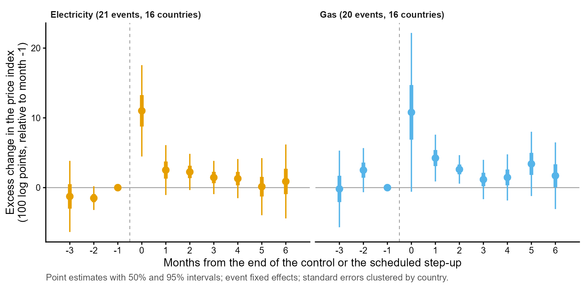
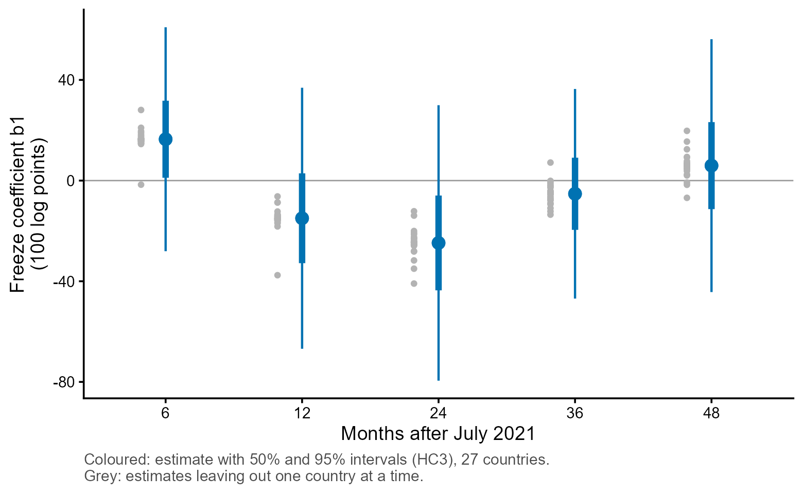

# Results of tests 1 to 4

13 November 2026. All tests follow the research design frozen on 8 November 2026 and its Amendments 1 to 3 ([`research_design.md`](research_design.md)), on the regime coding frozen on 12 November 2026. Checks that were not pre-specified are labelled as robustness. Tables are in `output/tables/`.

## Summary

When a price control on household energy ends, consumer prices jump. In the month a control on electricity ends or a scheduled step-up takes effect, the HICP electricity index rises 11.0 log points (about 12%) more than wholesale prices predict (standard error 3.3; 21 events in 16 countries), and 15.8 log points more over that month and the next two. For gas the jump over the three months is 17.6 log points (standard error 6.6; 20 events). These jumps survive month-of-year effects, a control for Europe-wide repricing in the same calendar month, and wild cluster bootstrap inference.

The cross-country test of whether controls lower the cumulative rise over the cycle (test 1) cannot separate postponing from preventing. Its point estimates have the postponing shape, but with 27 countries and few controlled ones the intervals include large effects of either sign. Test 3 finds no reliable effect of freezes on core inflation. In the first six months of the 2026 shock (test 4), countries with freezes or lagged formulas saw energy prices rise 5 to 7 log points less, an effect that is significant only once Spain, whose 2026 cuts depend on the CPI, is left out.

## Test 2: catch-up at exits and step-ups

Events are the 32 ends of codes 1 to 3 and the 9 scheduled step-ups recorded in the frozen coding. The outcome is the monthly change in 100 ln of the price index minus the change predicted by lags 0 to 12 of wholesale price changes (in national currency), estimated on uncontrolled country-months. The table gives the excess change relative to the month before the event, with event fixed effects and standard errors clustered by country.

| | Month −3 | Month −2 | Event month | +1 | +2 | Sum of months 0 to 2 |
|---|---|---|---|---|---|---|
| Electricity (21 events, 16 countries) | −1.3 (2.6) | −1.5 (0.9) | 11.0 (3.3) | 2.5 (1.8) | 2.3 (1.3) | 15.8 (5.4), p = 0.004 |
| Gas (20 events, 16 countries) | −0.2 (2.8) | 2.5 (1.6) | 10.8 (5.8) | 4.2 (1.7) | 2.6 (1.0) | 17.6 (6.6), p = 0.008 |

There is no rise before the event month. The results are nearly the same with the gas outcome on all gas (HICP 04.5.2) and with wholesale prices in euros. Split by type (exploratory), electricity exits alone give 11.9 (standard error 4.3) in the event month; for gas, the step-ups carry most of the jump and exits alone give 10.1 over three months (p = 0.13).

Robustness (not pre-specified; `test2_checks.csv`). Thirteen of the 41 events fall in January, when many tariffs reset. Adding month-of-year dummies to the prediction leaves the electricity event-month coefficient at 10.5. When the average excess change of uncontrolled countries in the same calendar month is also subtracted, it falls to 8.1 (wild cluster bootstrap p = 0.016) and raises the gas three-month sum to 28.2 (p = 0.012). In some 2023 months the uncontrolled reference group has only two countries, so this last variant is the noisiest. Wild cluster restricted bootstrap p-values (Webb weights, 9,999 draws) are close to the conventional ones in every variant.

## Test 1: postpone or prevent

The regression is run across 27 countries (Cyprus, Malta and Iceland have no wholesale price series) at each horizon after July 2021. The coefficient on the share of months under a freeze, b1, measures the difference in the cumulative rise in household energy prices, in log points, between a country under a freeze throughout and one with no control.

| Months after July 2021 | 6 | 12 | 24 | 36 | 48 |
|---|---|---|---|---|---|
| b1, freeze share | 16.4 | −15.0 | −24.8 | −5.2 | 6.0 |
| HC3 standard error | 22.7 | 26.5 | 27.9 | 21.3 | 25.6 |
| Permutation p | 0.42 | 0.52 | 0.33 | 0.77 | 0.78 |

The design predicted b1 < 0 at 6 and 12 months and b1 closer to zero at 48 months than at 12. The estimate is positive at 6 months, negative at 12 and 24, and close to zero by 36 and 48. The formal test D = b1(48) − b1(12) is 20.9, with a bootstrap 95% interval from −30.9 to 87.1; 77% of the bootstrap draws are positive. The test does not reject either hypothesis. Only 5 countries had any freeze in the first 6 months and 8 in the first 12, which limits what this regression can detect.

Two other coefficients stand out at 6 months. Countries whose prices were regulated before the shock saw a rise 24.9 log points smaller (standard error 11.4, p = 0.03); the difference is gone by 12 months. Countries with tax cuts saw a rise 33.4 log points larger (standard error 8.0, permutation p = 0.01). Governments cut taxes where prices were rising fastest, so the coefficient records that choice and cannot be read as an effect of the cuts. Quantity-based caps cannot be estimated before 2023, when only Estonia had one.

The all-gas and euro versions give coefficients within 2 points of these. Dropping countries with specially flagged records or those coded under Amendment 1 keeps the pattern: positive at 6 months, negative at 12 and 24, near zero or positive at 48. Dropping countries with low-coverage records (20 or 21 remain) or with unverified records (13 remain at 36 and 48 months) leaves b1 negative at every horizon from 12 to 48 months.

Leaving out one country at a time (not pre-specified; `test1_leave_one_out.csv`) shows that Belgium drives the early estimates. Without it, b1 is −1.6 at 6 months instead of 16.4, and −37.6 at 12 months instead of −15.0. Belgium is coded as a freeze because it extended its social tariff to a wider group, which covered about 19% of households; the other households faced the full rise. Across the 27 reduced samples, D ranges from 5.4 to 43.5, so its sign does not depend on any one country.

## Test 3: core inflation

With the HICP excluding energy, food, alcohol and tobacco as the outcome, b1 is 0.3, −1.6, −1.9, 1.0 and 7.5 log points at 6, 12, 24, 36 and 48 months, none significant (permutation p from 0.32 to 0.77). D is 9.1 (95% interval −6.1 to 21.5). The point estimates lean toward the prediction that controls raise core inflation later, but the data do not support it.

## Test 4: the 2026 shock (early evidence)

By the design's rule the 2026 shock starts in March 2026, the first month in which the European gas price exceeded its previous 12-month average by 50% or more (57% in dollars and in euros), so the base month is February 2026. Of the pre-specified horizons, only 6 months fits the data, which end in August 2026. Norway drops out because its electricity index is missing for February 2026, leaving 26 countries.

At 6 months, a country under a freeze throughout saw energy prices rise 5.5 log points less (standard error 3.9, permutation p = 0.13) and one under a lagged formula 7.2 less (standard error 5.1, p = 0.13). Without Spain, whose 2026 cuts are flagged because they depend on the CPI, the estimates are −8.7 (p = 0.008) and −10.4 (p = 0.008). Five countries in the sample had a freeze in this period (Croatia, Hungary, Lithuania, Romania and Slovakia). Wholesale exposure enters with 0.14 (standard error 0.05), and countries regulated in July 2021 saw a rise 8.6 points larger (standard error 4.2). Test 3 shows nothing for core inflation. Test 2 cannot be run: one control has ended since February 2026 (Romania, gas, April 2026).

## Limits

The results do not establish:

- Whether controls lowered the total rise over the full cycle. Test 2 shows that prices jump when controls end, but neither test measures how that jump compares with the rise held back earlier, and test 1 is too imprecise to say how much of the earlier saving is paid back.
- Causal effects of tax cuts. Their timing followed the price rises they responded to.
- Effects of quantity-based caps before 2023.
- Welfare. The HICP measures prices; bills paid, and with them transfers and bill credits, do not appear.
- Anything beyond six months for 2026.

Countries chose their controls, and the wholesale exposure and pre-shock regulation controls address only part of that choice. Test 2 is less exposed to it, because it compares each country's prices just before and just after a dated exit.
